<div align="center">

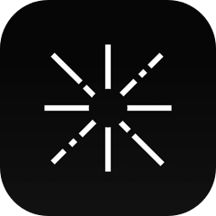

# Hear I am

**시각장애 공연자를 위한 무대 동선 안내 앱**<br>
음성과 비프음으로 방향 · 거리 · 장애물을 알려 줍니다

`iOS 17+` &nbsp; `LiDAR iPhone` &nbsp; `한국어 · English`

<br>

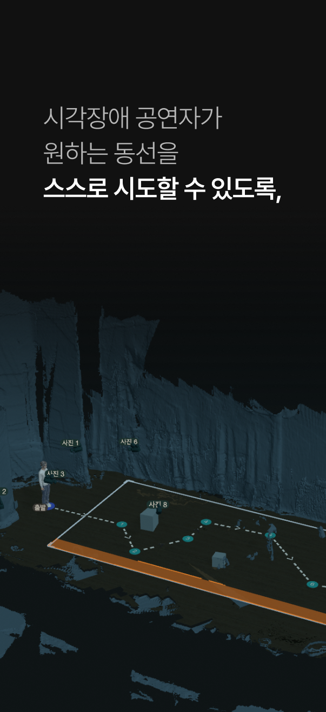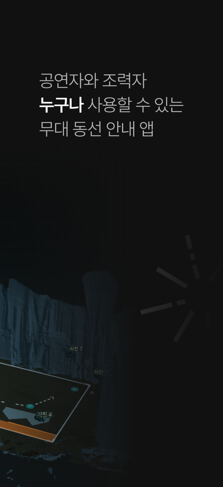

</div>

<br>

## 두 사람이 함께 씁니다

<table>
  <tr>
    <th width="50%">🎬&nbsp; 조력자</th>
    <th width="50%">🎧&nbsp; 공연자</th>
  </tr>
  <tr>
    <td valign="top">화면으로 무대를 준비합니다.<br>공간을 스캔하고, 동선을 저장하고, 공연별로 정리합니다.</td>
    <td valign="top">화면을 보지 않고 연습합니다.<br>「Hear I am」 하고 불러 말로 고르고, 소리를 따라 움직입니다.</td>
  </tr>
</table>

<br>

## 🎬 조력자 · 무대 준비

### 공연할 공간을 미리 담아두세요

무대를 스캔하고 경계 · 기물 · 확인점을 설정합니다.

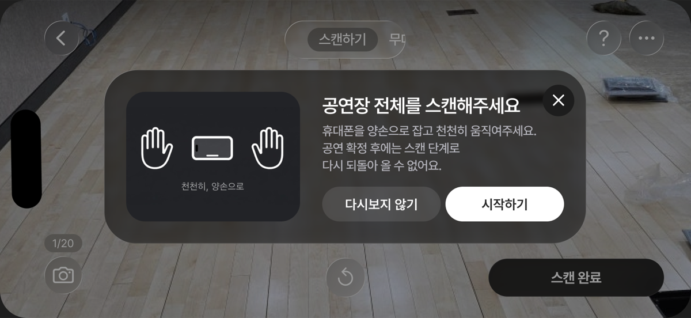

### 장면에 맞는 동선을 지점마다 저장해요

이동할 지점과 지점마다 머무를 시간, 바라볼 방향을 정해 공연에 쓸 동선을 준비합니다.

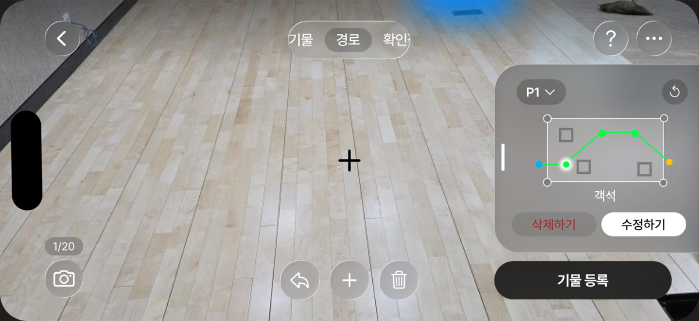

<table>
  <tr>
    <td width="45%" align="center">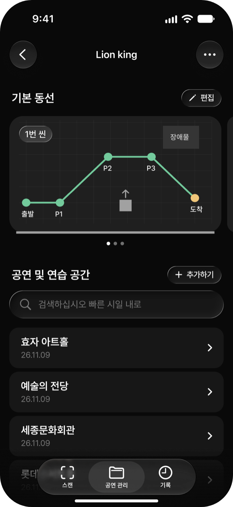</td>
    <td width="55%">
      <h3>공연마다 다른 무대,<br>체계적으로 관리해요</h3>
      공연 · 공연장 · 장면별로 무대를 정리하고, 각 장면에 필요한 동선을 미리 저장합니다.
    </td>
  </tr>
</table>

<br>

## 🎧 공연자 · 무대 사용

<table>
  <tr>
    <td width="55%">
      <h3>말로 고르는<br>오늘의 공연과 무대</h3>
      「Hear I am」 하고 부르면 대화가 열립니다. 사용할 공연과 무대를 말로 찾고, 연습용 또는 실전용을 고릅니다.
    </td>
    <td width="45%" align="center">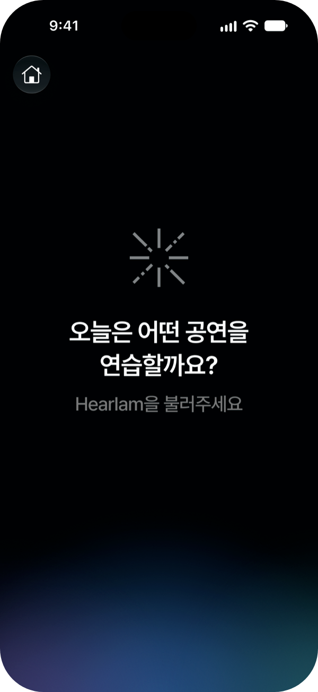</td>
  </tr>
  <tr>
    <td width="55%">
      <h3>방향부터 도착까지,<br>소리로 안내받아요</h3>
      허리에 찬 iPhone이 지금 위치와 방향을 읽고, 음성과 비프음으로 다음 지점까지 안내합니다. 진동은 쓰지 않습니다.
    </td>
    <td width="45%" align="center">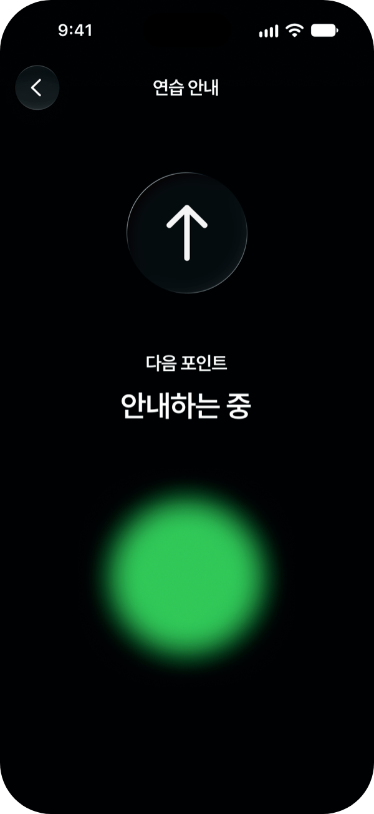</td>
  </tr>
</table>

<details>
<summary><b>안내 중에 들리는 소리</b></summary>

<br>

소리는 연결된 에어팟으로, 없으면 폰 스피커로 나갑니다.

| 언제 | 소리 |
|---|---|
| 출발 | 「현재 위치에서 P1으로 안내합니다」 → 첫 지점 쪽 「오른쪽」 · 「왼쪽」 |
| 방향이 틀림 (목표 ±30° 밖) | 「오른쪽」 · 「왼쪽」 한 번 → 톡톡톡(목표에 가까워질수록 빨라짐) |
| 방향이 맞음 | 확인음 한 번, 그 뒤 조용함 |
| 걷는 중 | 남은 거리 「1미터」, 마지막에 「50센티」 |
| 지점에 닿음 | 지점 이름(「피원」 · 「피투」) → 다음 지점 쪽 좌우 |
| 마지막 지점 | 띵 → 「마지막 지점 도착」 |
| 장애물 접근 | 1m · 0.6m · 0.35m 세 단계 경고음 |
| 다음 지점이 의자 · 계단 위 | 방향이 맞은 뒤 「의자」 · 「계단」 한 번 |
| 바라볼 방향이 정해진 지점 | 「그 자리에서 ○○ 방향을 바라봐주세요」 → 맞출 때까지 좌우 안내 |
| 장애물에 막히거나 동선 밖으로 벗어남 | 「멈추세요. 오른쪽(왼쪽)으로 비켜서세요」 |

도착은 지점 0.35m 안에 0.8초 머무르면 인정합니다. 출발점은 0.45m 안입니다.

</details>

<details>
<summary><b>자주 쓰는 말</b></summary>

<br>

| 말 | 하는 일 |
|---|---|
| Hear I am | 부르기. 대화가 열리고, 조용히 10초가 지나면 다시 닫힙니다 |
| 연습용 · 실전용 | 사용 방식 고르기 |
| 착용 완료 · 다음 | 다음 단계로 |
| 출발 | 안내 시작 |
| 멈춰 · 계속 | 안내 일시정지 · 다시 이어서 |
| 다시 말해 줘 | 방금 안내 다시 듣기 |
| P2로 다시 가 줘 | (연습용, 안내 시작 뒤) 그 지점으로 다시 안내 |
| 취소 · 이전 · 무대 다시 선택 | 한 단계 뒤로 · 무대 고르기로 |
| 닫기 | 대화 닫기 |

</details>

<br>

## 📼 공연이 끝난 뒤

<table>
  <tr>
    <td width="50%" align="center">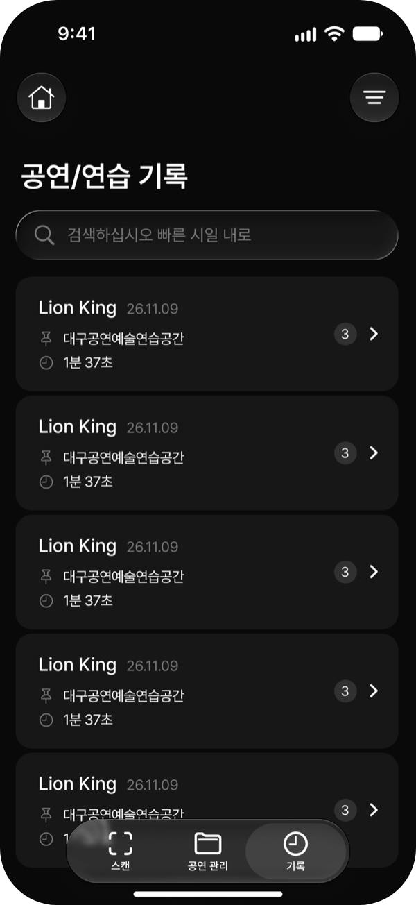</td>
    <td width="50%" align="center">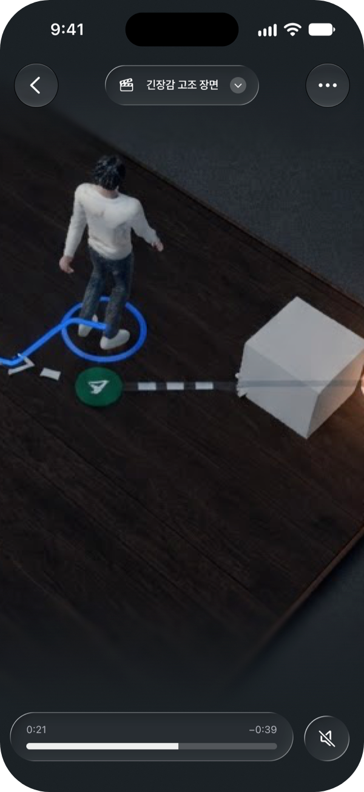</td>
  </tr>
  <tr>
    <td colspan="2" align="center">
      <h3>움직임을 함께 돌아봐요</h3>
      계획한 동선과 실제로 이동한 길을 다시 보며 피드백을 나눕니다.
    </td>
  </tr>
</table>

<br>

## 👥 팀

<table>
  <tr>
    <th colspan="2" align="center"><br>🧭&nbsp; PM<br><br></th>
    <th colspan="1" align="center"><br>🎨&nbsp; Designer<br><br></th>
    <th colspan="3" align="center"><br>💻&nbsp; Developer<br><br></th>
  </tr>
  <tr>
    <td align="center" width="16%"><br></td>
    <td align="center" width="16%"><br></td>
    <td align="center" width="16%"><br></td>
    <td align="center" width="16%"><br></td>
    <td align="center" width="16%"><br>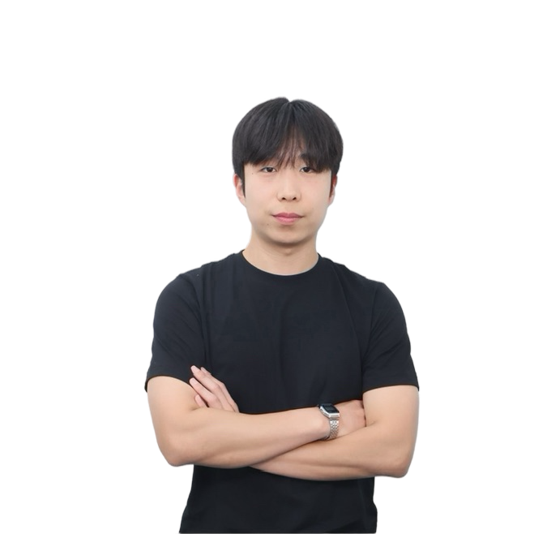</td>
    <td align="center" width="16%"><br></td>
  </tr>
  <tr>
    <td align="center"><h3>TOM</h3>(우상영)<br><br></td>
    <td align="center"><h3>CLAIRE</h3>(김경민)<br><br></td>
    <td align="center"><h3>KYEOZO</h3>(조원경)<br><br></td>
    <td align="center"><h3>NANA</h3>(김나영)<br><br></td>
    <td align="center"><h3>JACE</h3>(김재원)<br><br></td>
    <td align="center"><h3>IAN</h3>(김지원)<br><br></td>
  </tr>
</table>

<p align="center"><sub>Apple Developer Academy @ POSTECH · 2026 Challenge 6 · A13</sub></p>

<br>

## 🛠 개발

<details>
<summary><b>빌드하기</b></summary>

<br>

- iOS 17 이상. 스캔 · 공간 복원 · 안내는 LiDAR가 있는 iPhone 실기기에서 확인합니다. 시뮬레이터로는 화면 흐름 정도만 볼 수 있습니다.
- Xcode에서 [Hear-I-am.xcodeproj](Hear-I-am.xcodeproj)를 열고 **Hear-I-am** scheme으로 빌드합니다.
- Metal Toolchain이 없다는 오류가 나면 `xcodebuild -downloadComponent MetalToolchain` 을 한 번 실행합니다.
- 파일을 더하거나 옮긴 뒤에는 저장소 루트에서 `xcodegen generate` 를 실행합니다.
- Signing & Capabilities의 개발 팀 · 번들 ID 변경은 각자 로컬에만 두고 커밋하지 않습니다.
- 번들 ID(`org.heariam.poc4.scanlab`)는 기존 TestFlight 앱의 저장 무대를 잇기 위해 예전 이름을 그대로 씁니다.
- 코어 테스트: `sh scripts/test-core.sh`
- 이슈 · 브랜치 · PR 규칙은 [CONTRIBUTING.md](CONTRIBUTING.md)를 따릅니다.

</details>

<details>
<summary><b>폴더 구조</b></summary>

<br>

```text
Hear-I-am/
├── App/Source/       # @main · 역할 선택과 화면 전환(HearRootView)
├── Core/             # 여러 기능이 함께 쓰는 것: AR 세션 · 오디오 · 로그 · 저장 · 디자인 시스템
├── Features/         # 기능별 Model / View / ViewModel
│   ├── Onboarding                         # 시작 로고와 역할 선택
│   ├── Home · Voice                       # 공연자 홈과 음성 대화
│   ├── Preparation · Guidance             # 무대 준비(스캔)와 안내
│   ├── Performances · Places · Planning   # 공연 관리 · 공간 폴더 · 사전 동선
│   ├── Records · StagePreview             # 완료 기록 · 공간 다시보기
│   └── SoundTest                          # 설정의 신호 연습
└── Resources/        # Assets · 다시보기 인물 · 기물 모델

Packages/HearIAmCore/ # 화면과 무관한 규칙과 테스트(도착 · 이탈 판정, 신호, 음성 명령 해석, 저장 형식)
```

- 의존 방향은 View → ViewModel → Core → HearIAmCore 한쪽입니다.
- 판정 규칙과 저장 형식은 HearIAmCore에 두고 테스트를 붙입니다.
- 기능별 실험 기록과 자세한 동작은 [Experiments/](Experiments/)에 있습니다.

</details>

<details>
<summary><b>기록 파일</b></summary>

<br>

앱 Documents에 저장되고 파일 앱에서 볼 수 있습니다.

| 경로 | 내용 |
|---|---|
| `Scans/<UUID>/` | 공간 지도 · 메시 · manifest(무대 · 동선 · 기물) · 현장 사진 |
| `Performances/` | 공연 폴더 · 참고 씬 · 공간 폴더 연결 |
| `PerformancePlans/` | 사전 저장 동선 |
| `GuidanceRecords/<UUID>.json` | 끝까지 마친 안내의 완료 기록 |
| `Trials/trial-<UUID>.jsonl` | 안내마다 위치와 소리 · 음성 신호 기록 |
| `VoiceLogs/voice-<날짜>.jsonl` | 음성 대화 기록(들은 말 · 앱 답 · 단계 변화) |

</details>
