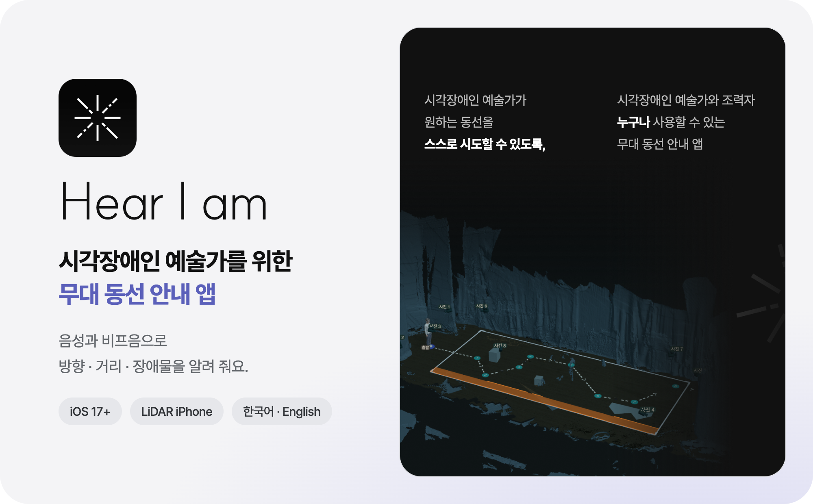
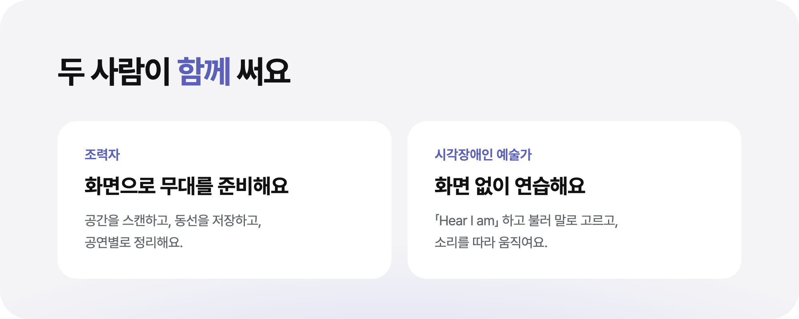
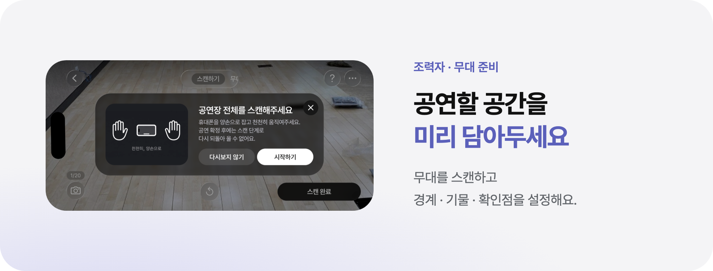
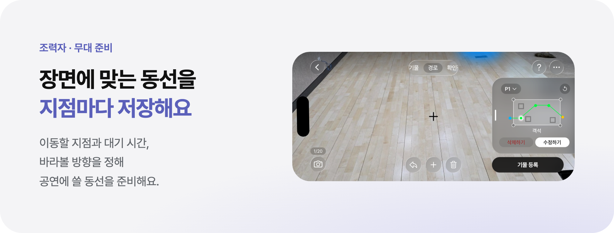
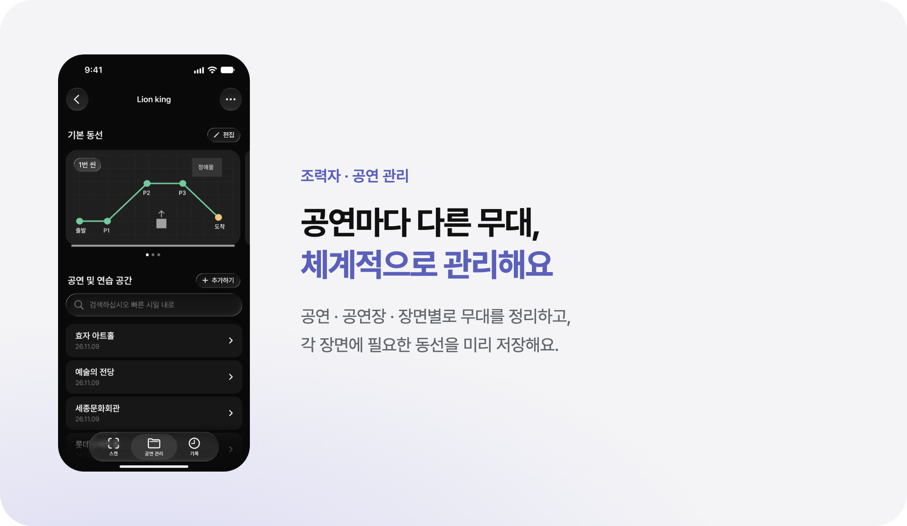
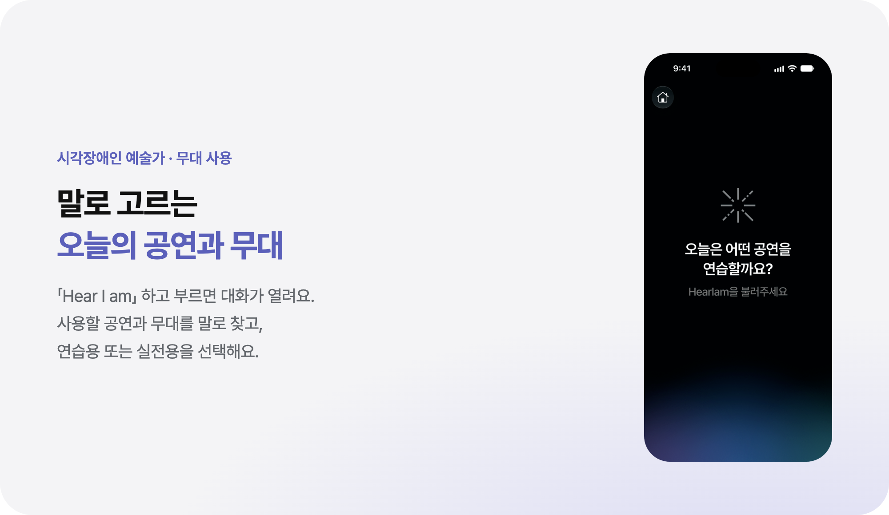
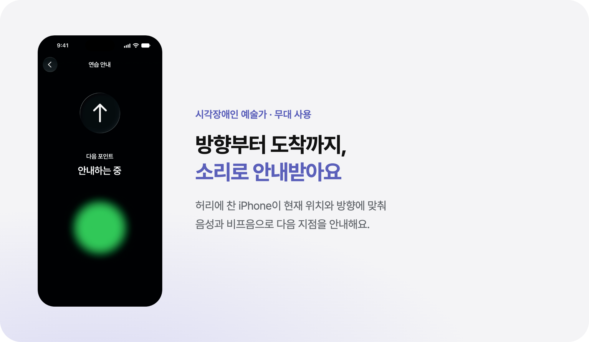
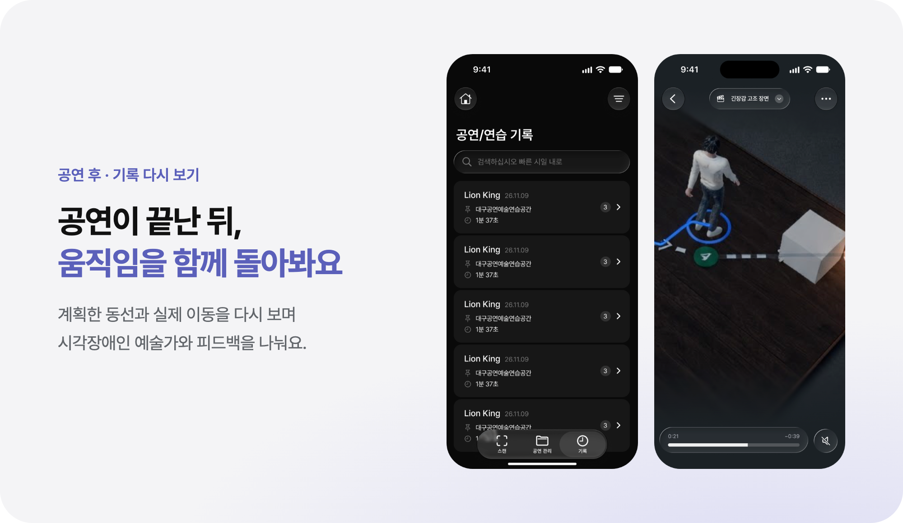
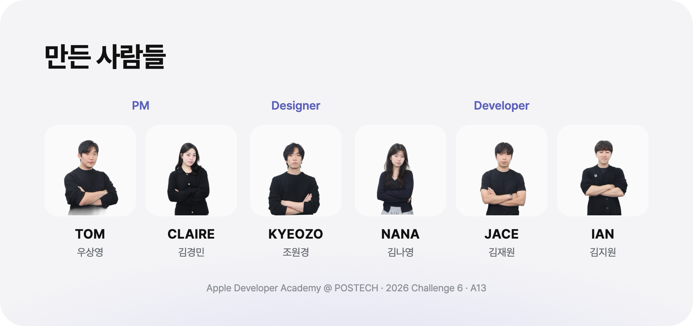

<picture>
  <source media="(prefers-color-scheme: dark)" srcset=".github/assets/readme/card-hero.png">
  
</picture>

<br>

<picture>
  <source media="(prefers-color-scheme: dark)" srcset=".github/assets/readme/card-roles.png">
  
</picture>

<br>

<picture>
  <source media="(prefers-color-scheme: dark)" srcset=".github/assets/readme/card-scan.png">
  
</picture>

<br>

<picture>
  <source media="(prefers-color-scheme: dark)" srcset=".github/assets/readme/card-route.png">
  
</picture>

<br>

<picture>
  <source media="(prefers-color-scheme: dark)" srcset=".github/assets/readme/card-manage.png">
  
</picture>

<br>

<picture>
  <source media="(prefers-color-scheme: dark)" srcset=".github/assets/readme/card-voice.png">
  
</picture>

<br>

<picture>
  <source media="(prefers-color-scheme: dark)" srcset=".github/assets/readme/card-guide.png">
  
</picture>

<br>

<picture>
  <source media="(prefers-color-scheme: dark)" srcset=".github/assets/readme/card-records.png">
  
</picture>

<br>

<picture>
  <source media="(prefers-color-scheme: dark)" srcset=".github/assets/readme/card-team.png">
  
</picture>

<br>

## 🛠 개발

<details>
<summary><b>빌드하기</b></summary>

<br>

- iOS 17 이상. 스캔 · 공간 복원 · 안내는 LiDAR가 있는 iPhone 실기기에서 확인합니다. 시뮬레이터로는 화면 흐름 정도만 볼 수 있습니다.
- Xcode에서 [Hear-I-am.xcodeproj](Hear-I-am.xcodeproj)를 열고 **Hear-I-am** scheme으로 빌드합니다.
- Metal Toolchain이 없다는 오류가 나면 `xcodebuild -downloadComponent MetalToolchain` 을 한 번 실행합니다.
- 파일을 더하거나 옮긴 뒤에는 저장소 루트에서 `xcodegen generate` 를 실행합니다.
- Signing & Capabilities의 개발 팀 · 번들 ID 변경은 각자 로컬에만 두고 커밋하지 않습니다.
- 번들 ID(`org.heariam.poc4.scanlab`)는 기존 TestFlight 앱의 저장 무대를 잇기 위해 예전 이름을 그대로 씁니다.
- 코어 테스트: `sh scripts/test-core.sh`
- 이슈 · 브랜치 · PR 규칙은 [CONTRIBUTING.md](CONTRIBUTING.md)를 따릅니다.

</details>

<details>
<summary><b>폴더 구조</b></summary>

<br>

```text
Hear-I-am/
├── App/Source/          # @main · 역할 선택과 화면 전환(HearRootView)
├── Core/                # 여러 기능이 함께 쓰는 것
│   ├── AR/              # AR 세션 · 스캔 렌더링 · 현장 사진
│   ├── Audio/           # 오디오 세션 · 신호음 · 음성 안내
│   ├── DesignSystem/    # 색 · 글꼴 · 공통 부품
│   ├── Haptics/         # 방향 진동
│   ├── Logging/         # 시험 기록 · 진단 로그 정리
│   └── Store/           # 저장한 무대 목록(StageLibrary)
├── Features/            # 기능별 Model / View / ViewModel
│   ├── Onboarding/      # 시작 로고와 역할 선택
│   ├── Preparation/     # 조력자: 무대 스캔 · 경계 · 기물 · 확인점
│   ├── Planning/        # 조력자: 기본 동선 편집
│   ├── Performances/    # 조력자: 공연 · 장면별 관리
│   ├── Places/          # 조력자: 공간 폴더
│   ├── Records/         # 조력자: 완료 기록 · 이동 다시 재생
│   ├── StagePreview/    # 조력자: 저장한 공간 3D 보기
│   ├── Home/            # 시각장애인 예술가: 홈 · 설정 · 도움말
│   ├── Voice/           # 시각장애인 예술가: 「Hear I am」 부르기 · 음성 대화
│   ├── Guidance/        # 시각장애인 예술가: 소리로 동선 안내
│   └── SoundTest/       # 설정의 신호 · 정면 방향 연습
└── Resources/           # Assets · 글꼴 · 다시보기 인물과 기물 모델

Packages/HearIAmCore/    # 화면과 무관한 규칙과 저장 형식
├── Sources/HearIAmCore/
│   ├── Guidance/        # 출발 · 진행 · 도착 판정
│   ├── Signal/          # 방향 · 거리 · 경고 신호
│   ├── Voice/           # 부르는 말 · 음성 명령 해석
│   ├── Stage/           # 동선 · 기물 · 위험 구역
│   ├── Geometry/        # 무대 좌표 · 바닥면
│   ├── Storage/         # 공연 · 스캔 · 기록 저장 형식
│   ├── Places/          # 공간 폴더 저장
│   └── Localization/    # 한국어 · 영어
└── Tests/               # 코어 테스트

Experiments/             # 기능별 실험 기록
scripts/                 # 코어 테스트 실행 · 다시보기 모델 변환
```

- 의존 방향은 View → ViewModel → Core → HearIAmCore 한쪽입니다.
- 판정 규칙과 저장 형식은 HearIAmCore에 두고 테스트를 붙입니다.
- 기능별 실험 기록과 자세한 동작은 [Experiments/](Experiments/)에 있습니다.

</details>

<details>
<summary><b>기록 파일</b></summary>

<br>

앱 Documents에 저장되고 파일 앱에서 볼 수 있습니다.

| 경로 | 내용 |
|---|---|
| `Scans/<UUID>/` | 공간 지도 · 메시 · manifest(무대 · 동선 · 기물) · 현장 사진 |
| `Performances/` | 공연 폴더 · 참고 씬 · 공간 폴더 연결 |
| `PerformancePlans/` | 사전 저장 동선 |
| `GuidanceRecords/<UUID>.json` | 끝까지 마친 안내의 완료 기록 |
| `Trials/trial-<UUID>.jsonl` | 안내마다 위치와 소리 · 음성 신호 기록 |
| `VoiceLogs/voice-<날짜>.jsonl` | 음성 대화 기록(들은 말 · 앱 답 · 단계 변화) |

</details>
